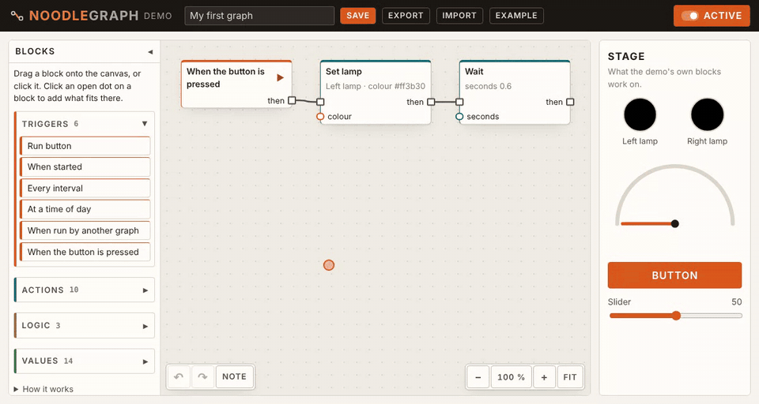
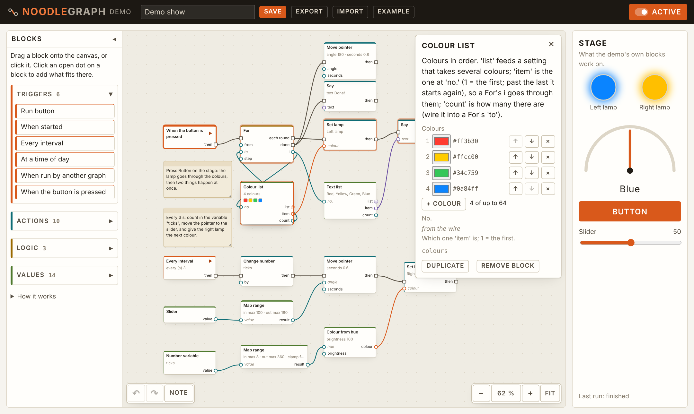
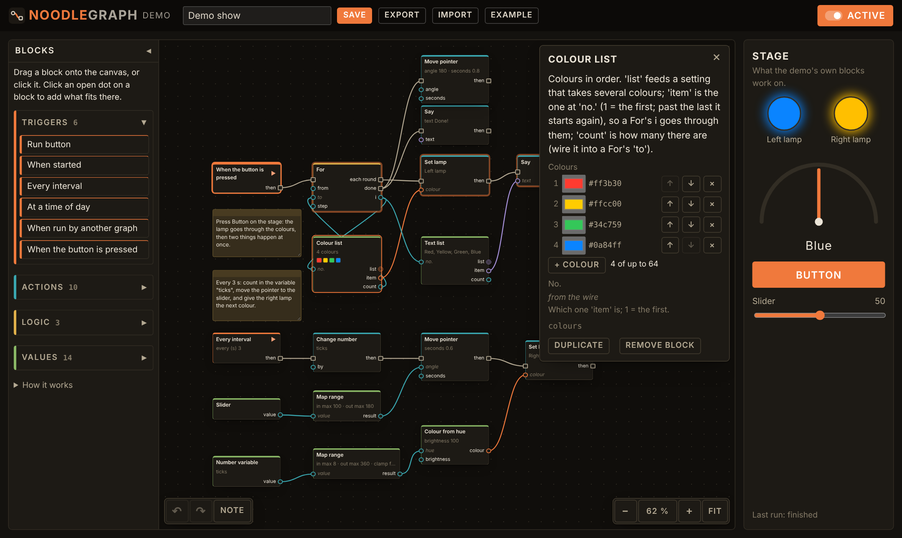

<p align="center">
  
</p>

<p align="center">
  <strong>Block coding for any application.</strong><br>
  You bring the blocks. Noodlegraph draws the graph, checks it and runs it.
</p>

<p align="center">
  
  
  
  
</p>

<p align="center">
  
</p>

<p align="center">
  <a href="docs/GUIDE.md"><strong>Step-by-step guide</strong></a> ·
  <a href="docs/index.html">Documentation</a> ·
  <a href="demo/">Demo</a> ·
  <a href="spec/SPEC.md">Specification</a> ·
  <a href="CHANGELOG.md">Changelog</a>
</p>

## What it is

A trigger block starts a chain of blocks along the white wires. Coloured wires ("noodles")
carry values into a block's settings. Two white wires from one block run at the same time. The
picture is the file: what is drawn is what runs.

Noodlegraph knows nothing about what your blocks do. Lamps, motors, sounds, orders, game
characters: you describe a block in a dozen lines and it appears in the editor, gets checked
and runs.

| | |
|---|---|
| **An editor people enjoy** | Dots that fit light up while you drag a wire. Click a dot and pick what comes next. Undo, copy and paste, several blocks at once, notes on the canvas, light and dark. |
| **An engine you can trust** | A graph with a mistake does not run, and the mistake is named in plain words. A failing block ends its own chain, never the engine. Stop means stop. |
| **Nothing to install** | Plain JavaScript modules and one CSS file. No dependencies, no build step, no server: the whole thing runs in a page. |
| **Not tied to a platform** | A written specification and shared test graphs keep every runtime the same. JavaScript and Python today. |

<p align="center">
  
  
</p>

## What you can build with it

- **Animatronics and show control.** Operators build routines that react to sensors and move
  servos, lights and sound, without writing code. Noodlegraph started as the routine editor of
  Stagion, a stage and show controller.
- **Robotics.** People design a robot's behaviour as a graph: when a person is seen, turn the
  head, then wave.
- **Home and building automation.** Triggers, conditions and actions for devices, as a friendlier
  face for rules.
- **Game and interactive logic.** Designers wire up quests, puzzles or exhibit interactions;
  developers supply the blocks.
- **IoT and hardware projects.** The Python runtime runs on a small Linux board next to the
  hardware.
- **Teaching.** A first look at programming, with blocks of your own choosing.

## How it works

Noodlegraph is a library, not a platform. Your application defines the blocks: their names,
their settings and what they do. People wire those blocks into graphs in the editor. A graph is
saved as plain JSON, and Noodlegraph's engine runs it directly inside your application (in the
browser, in Node.js or in Python), calling your blocks as the graph says. Nothing is compiled
and no code is generated, so a changed graph runs straight away.

## Try it

```
./start.sh              # macOS, Linux
start.bat               # Windows: double-click it
```

That serves this folder and opens the documentation, which starts with a live editor. The demo
is at `/demo/`. The scripts need Python only to serve files; any static web server does the
same (`npx serve`, `python -m http.server`).

**New here?** The [step-by-step guide](docs/GUIDE.md) goes from nothing to your own block
running in your own page, with a short film for each step.

The demo is a small application around Noodlegraph: a stage with two lamps, a pointer, a button
and a slider, and five blocks of its own. Press **Button** on the stage, or ▶ on a trigger block.
Change the graph, press **Save**, and the new graph runs.

## How it is organised

Three layers. The specification is shared; editors and runtimes exist per platform and are all
built against it, so a graph drawn in any editor runs the same way on any runtime.

| Layer | Folder | What it is | Platforms today |
|---|---|---|---|
| **Specification** | `spec/` | The graph file, the block catalogue, the rules for checking and running, and test graphs every runtime must pass | one, for all |
| **Editors** | `editors/` | What draws a graph | `web`: any browser or web view |
| **Runtimes** | `runtimes/` | What checks and runs a graph | `javascript`: browser, Node.js. `python`: Python 3.11+ |

```
spec/                    the specification, JSON Schemas, test graphs
editors/web/             noodlegraph.js (createEditor), panzoom.js, noodlegraph.css
runtimes/javascript/     Engine, defineBlock, STANDARD, check, parse, catalogue
runtimes/python/         the same in Python (needs pydantic and PyYAML)
demo/                    a small application, all in the browser
examples/first-app/      the pages of the step-by-step guide
docs/                    the documentation site
```

## Using it in an application

```html
<link rel="stylesheet" href="editors/web/noodlegraph.css">
<div id="editor" style="height: 70vh"></div>
<script type="module">
  import { createEditor } from "./editors/web/noodlegraph.js";
  import { Context, Engine, STANDARD, catalogue, defineBlock, parse, registry } from "./runtimes/javascript/src/index.js";

  // 1. The host as blocks see it
  class Stage extends Context {
    lamp = "#000000";
  }

  // 2. A block of the host's own
  const SetLamp = defineBlock({
    role: "action", kind: "set_lamp", title: "Set lamp", help: "Gives the lamp a colour.",
    inputs: [{ name: "in", type: "flow" }, { name: "colour", type: "colour" }],
    fields: [{ name: "colour", kind: "colour", default: "#ff8800" }],
    run({ ctx, inputs }) { ctx.lamp = inputs.colour; return "out"; },   // [r, g, b]; "out": continue there
  });

  // 3. Engine and editor share the block types
  const blocks = registry(STANDARD, SetLamp);
  const engine = new Engine({ context: new Stage(), registry: blocks, onEvent: (graph, e) => e.event === "step" && editor.step(e.node) });
  const editor = createEditor(document.querySelector("#editor"), {
    blocks: catalogue(blocks),
    graph: { id: "hello", enabled: true, nodes: [], wires: [] },
    onRun: (node) => engine.fire("hello", node),
  });

  // 4. Save: the editor's graph goes to the engine
  async function save() { await engine.load([parse(editor.getGraph())]); }
  await save();
  await engine.activate();
</script>
```

`demo/demo.js` is this with a name field, Save, an Active switch, Import and Export.

### With a coding agent

[`AGENTS.md`](AGENTS.md) is written for coding agents (Claude Code, Cursor, Copilot and the
like): what to copy, working code, the rules for blocks, and a list to check the result against.
Put this repository where the agent can read it and say:

```text
Read AGENTS.md in the noodlegraph folder and follow Part 1 to put Noodlegraph into this
application. People should be able to draw graphs that <what graphs should do>.
Make blocks for: <the actions, triggers and values of the application>.
Graphs run <in the browser | in Node.js | in Python> and are kept <where>.
Go through "Check your work" at the end and tell me which points you could not check.
```

## Custom blocks

A block type is its description (what the editor draws) plus one function (what the engine
runs), by its **role**:

| Role | Function | It does |
|---|---|---|
| `trigger` | `start({ ctx, options, emit })`, returning how to stop; or `watch({ ..., sleep })`, an async function that runs until stopped | Calls `emit()` when its thing happens |
| `action` | `run({ ctx, options, inputs, sleep, signal, state })` | One step; returns the name of the flow output to continue on |
| `loop` | `again({ inputs, rounds })`, `values({ inputs, rounds })` | Says whether another round runs, and what its outputs are in it |
| `value` | `compute({ ctx, options, inputs })` | Returns `{ output: value }` |

- **Settings** are `fields`: `int`, `float`, `bool`, `text`, `select`, `colour`, `time`, the
  lists `numbers`, `texts`, `colours`, or a kind of your own (the editor shows it as a
  dropdown of your `choices`, or draws it with your own `fields` function).
- **A value input has the name of a field.** Wired, the wire's value is used; otherwise the
  field.
- **Value types:** `number`, `bool`, `text`, `colour` and lists of them. Add your own with
  `registerType("pose", convert)` and tell the editor its colour (`types`).
- **Groups:** blocks are listed under Triggers, Actions, Logic and Values, or groups of your
  own (`category` on the block, `categories` in the editor).
- **Waiting** goes through `sleep(seconds)`, so a cancelled chain stops at once.
- **The host** is reached only through `ctx`, your subclass of `Context`. Override
  `release()` to return to a safe state when the engine stops.

In Python the same block is a class:

```python
class SetLamp(Action):
    kind = "set_lamp"
    title = "Set lamp"
    inputs = (Port("in", "flow"), Port("colour", "colour"))

    class Options(BlockOptions):
        colour: str = Field(default="#ff8800", json_schema_extra=ui("colour"))

    async def run(self, inputs):
        self.ctx.lamp = inputs["colour"]
        return "out"
```

Both runtimes come with the same 28 standard blocks:

- **Triggers:** Run button, When started, Every interval, At a time of day, When run by
  another graph.
- **Steps:** Wait, If, For, While, Run graph.
- **Variables:** Set and read numbers, texts, yes / no and colours; Change number counts.
- **Values:** Number, Text, the three lists, Map range, Compare, Colour from hue, Random.

A block gets the variables of its graph as `variables` (a Map; a dict in Python) and can run
another graph with `call(graphId)`.

## The API

### Runtime (JavaScript names; Python in brackets where it differs)

| | |
|---|---|
| `defineBlock(spec)` (subclass `Trigger`, `Action`, `Loop`, `ValueBlock`) | A block type. |
| `registry(STANDARD, ...blocks)` | Block types by kind. |
| `catalogue(registry)` | The block types as the editor wants them. |
| `parse(document)` | A graph from JSON (text or object); refuses a malformed one. |
| `check(graph, registry, ctx)` | Checks a graph; `.problems` lists what is wrong, in words for the user. |
| `new Engine({ context, registry, limits, onEvent, onStatus })` (`Engine(ctx, registry, limits=, on_event=, on_status=)`) | Runs graphs. |
| `engine.load(graphs)`, `activate()`, `deactivate()` | Replace the graphs; start listening; stop everything. |
| `engine.fire(graphId, nodeId)`, `cancel(graphId)` | Start a chain by hand; cancel a graph's chains. |
| `engine.evaluate(graphId, nodeId, port)` | A value without a chain, for graphs that only calculate. |
| `engine.status()` | What is loaded, valid, listening and running. |
| `limits` | Longest chain, steps, shortest loop round, nesting. |
| `registerType(name, convert)` (`register_type`) | A value type of your own. |

Python also has `GraphStore(folder)` for graph files (`<id>.yaml`, JSON reads too).

### Editor

`createEditor(element, options)`. The element needs a height.

| Option | What it is |
|---|---|
| `blocks`, `graph` | The block types and the document to edit. |
| `readOnly` | Look, select and pan, but change nothing. |
| `choices` | What settings of your own kinds offer: `{ lamp: [{ value, label }] }`, or a function. |
| `fields` | Settings you draw yourself: `{ kind: ({ node, field, value, set, disabled }) => Element }`. |
| `types`, `categories` | Colours and names of your own value types and block groups. |
| `text` | Any wording of the editor (see `TEXT` in `noodlegraph.js`): another language, other terms. |
| `storageKey`, `quiet` | Where the browser remembers zoom and folds; settings left out of a block's summary. |
| `onChange(graph)`, `onSelect(selection)`, `onRun(nodeId)` | What happened. |

The handle it returns: `getGraph()`, `setGraph(graph)`, `setBlocks()`, `setChoices()`,
`setReadOnly()`, `setRunning([nodeId])`, `step(nodeId)`, `select()`, `addNode()`, `connect()`,
`removeSelected()`, `fit()`, `destroy()`.

The handle also has `undo()`, `redo()`, `copy()`, `paste()`, `duplicate()` and `selectAll()`.

The handle also has `setTheme(theme)`.

The editor has no Save button, name field or list of graphs: those belong to the host.

### Colours and fonts

Give the editor a `theme`: the name of one that comes with it (`"paper"`, `"slate"`,
`"contrast"`) or your own colours. Whatever you leave out keeps its look.

```js
createEditor(element, { theme: "slate" });
createEditor(element, { theme: { accent: "#2f6fed" } });
createEditor(element, { theme: {
  fontBody: "Inter, sans-serif",
  light: { accent: "#2f6fed", canvas: "#eef2f7" },
  dark:  { accent: "#6ea3ff", canvas: "#10151c" },
} });
editor.setTheme("contrast");
```

The names: `accent`, `onAccent`, `surface`, `canvas`, `ink`, `inkSoft`, `inkFaint`, `line`,
`lineStrong`, `action`, `value`, `logic`, `text`, `danger`, `fontDisplay`, `fontBody`,
`fontMono` (`THEME_VARIABLES` in `noodlegraph.js` says what each one colours). Dark follows the
system, or `data-theme="dark"` / `"light"` on the editor's element or a parent. Under it all are
`--ng-*` CSS variables, if you would rather set those in a style sheet.

### In the editor

| To | Do |
|---|---|
| Add a block | Drag it from Blocks, click it there, or click a dot and pick what fits |
| Wire | Drag from a dot to a dot. The dots that fit light up, and the wire snaps to a near one |
| Do two things at once | Drag a second wire from the same white dot |
| Write a note on the canvas | Note, at the bottom left. Its top edge moves it, its corner sizes it |
| Select several blocks | Shift-click them, or Shift-drag a frame on the canvas. Ctrl+A selects all |
| Move | Drag a block; a selection moves together |
| Copy, paste, duplicate | Ctrl+C, Ctrl+V, Ctrl+D |
| Remove | Delete or Backspace |
| Undo, redo | Ctrl+Z, Ctrl+Shift+Z (or Ctrl+Y), or the arrows at the bottom left |
| Pan and zoom | Drag the canvas; wheel or pinch; + and −; 0 shows everything |

On a Mac, Cmd takes the place of Ctrl.

## Another platform later

- **Another language for running** (C#, C++, ...): write a runtime against `spec/SPEC.md` and
  make it pass `spec/tests/`. The existing runtimes are about 1,000 lines of JavaScript and 2,000 of Python.
- **Another UI for drawing** (a native toolkit): write an editor that reads and writes the
  graph document and takes the block catalogue. `editors/web` in a web view covers desktop
  applications without that.
- **No shared code is needed** between platforms: the spec and its test graphs keep them
  the same.

## Tests

```
cd runtimes/javascript && npm test              # 42 tests
python -m pytest runtimes/python                # 49 tests
```

Both include the shared test graphs of `spec/tests/`.

## Not there yet

Passing values into and out of a graph that another graph runs, groups on the canvas, stepping
through a run, and standard maths and text blocks. The editor is not checked on touch screens.

## Licence

Copyright (c) 2026 Eagle Creative. Noodlegraph has two licences:

- **AGPL-3.0-or-later** ([LICENSE](LICENSE)): free for any purpose. Software that includes
  Noodlegraph and is given to others, or used by others over a network, publishes its complete
  source under the same licence, and keeps the notice that it uses Noodlegraph by Eagle Creative.
- **Commercial** ([COMMERCIAL.md](COMMERCIAL.md)): for products whose source stays closed.

[LICENSE.md](LICENSE.md) explains which one applies. To contribute, see
[CONTRIBUTING.md](CONTRIBUTING.md); changes are listed in [CHANGELOG.md](CHANGELOG.md).
