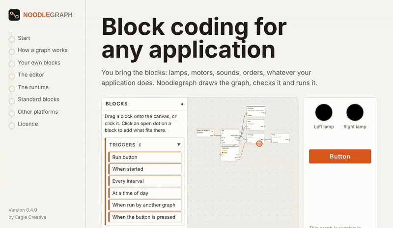
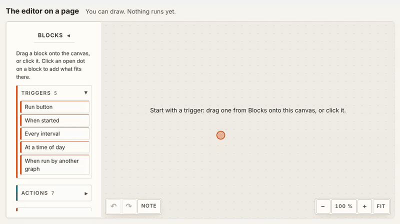
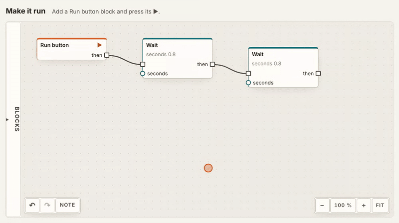
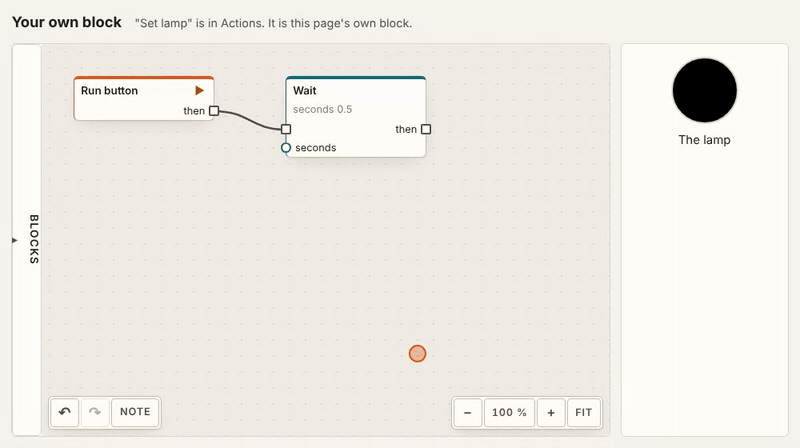
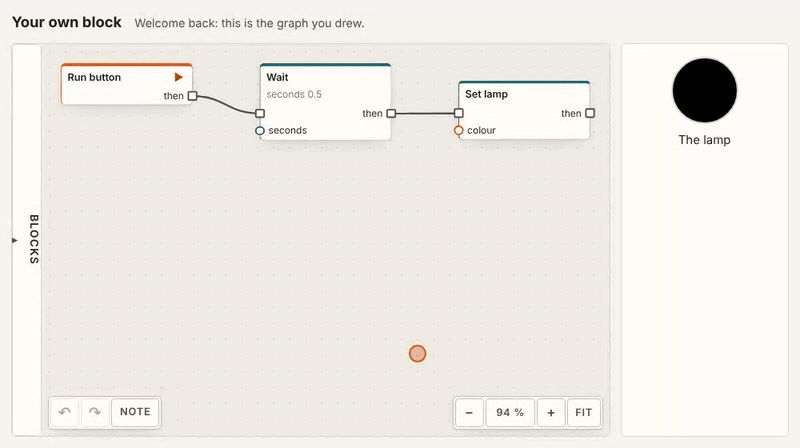

# Set Noodlegraph up, step by step

Five steps from nothing to your own block running in your own page. Each step has a short
film of what you should see, and a page in [`examples/first-app/`](../examples/first-app/) that
you can open, read and copy. The films were recorded from those pages.

You need a browser, and something that serves files (Python does; so does `npx serve`).
You do not need to install or build anything.

| Step | You get | Page |
|---|---|---|
| [1. Get it and start it](#1-get-it-and-start-it) | Noodlegraph running on your machine | |
| [2. Put the editor on a page](#2-put-the-editor-on-a-page) | An editor you can draw in | `step1.html` |
| [3. Make it run](#3-make-it-run) | Graphs that run as you draw them | `step2.html` |
| [4. Add a block of your own](#4-add-a-block-of-your-own) | A block that controls your application | `step3.html` |
| [5. Keep the graph](#5-keep-the-graph) | The graph is there again next time | `step3.html` |

## 1. Get it and start it

Download or clone the repository, then start it from its folder:

```
./start.sh          # macOS, Linux
start.bat           # Windows: double-click it
```

Your browser opens the documentation. The editor at the top is live: press **Button** and the
graph runs.



**If nothing opens:** go to `http://localhost:8760/docs/` yourself. If the script says it needs
Python, install Python 3, or run `npx serve -l 8760` in the folder instead.

The pages of the next steps are at `http://localhost:8760/examples/first-app/`.

## 2. Put the editor on a page

The editor is three files in `editors/web/`. A page needs the style sheet, an element with a
height, and one call:

```html
<link rel="stylesheet" href="editors/web/noodlegraph.css">
<div id="editor" style="height: 70vh"></div>

<script type="module">
  import { createEditor } from "./editors/web/noodlegraph.js";
  import { STANDARD, catalogue, registry } from "./runtimes/javascript/src/index.js";

  const blocks = registry(STANDARD);                 // the block types people may use

  createEditor(document.querySelector("#editor"), {
    blocks: catalogue(blocks),                       // ... described for the editor
    graph: { id: "first", enabled: true, nodes: [], wires: [] },
  });
</script>
```

Open `step1.html`. Click **Run button** in Blocks, click the dot on its right, and pick
**Wait** from what fits. Click the Wait block to change its seconds.



You can draw, but nothing runs: there is no engine yet.

**If the page stays empty:** it was opened as a file (`file://…`). Browsers only load modules
from a server, so open it through `http://localhost:8760/…`.

## 3. Make it run

An **engine** checks graphs and runs them. Hand it every change from the editor, and what is
drawn is what runs:

```js
import { Engine, STANDARD, catalogue, check, parse, registry } from "./runtimes/javascript/src/index.js";

const blocks = registry(STANDARD);

const engine = new Engine({
  registry: blocks,
  onEvent(graphId, event) {
    if (event.event === "step") editor.step(event.node);     // flash the block the chain is at
  },
});

async function load(graph) {
  const parsed = parse(graph);                               // refuses a malformed document
  const problems = check(parsed, blocks).problems;           // what is wrong, in plain words
  await engine.load([parsed]);
  if (problems.length) console.warn(problems);
}

const editor = createEditor(document.querySelector("#editor"), {
  blocks: catalogue(blocks),
  graph: { id: "first", enabled: true, nodes: [], wires: [] },
  onChange: load,                                            // every edit goes to the engine
  onRun: (nodeId) => engine.fire("first", nodeId),           // the ▶ on a trigger block
});

await load(editor.getGraph());
await engine.activate();                                     // nothing runs before this
```

Open `step2.html`, build Run button → Wait → Wait, and press **▶** on the Run button block.
Each block lights up as the chain reaches it.



`engine.deactivate()` stops everything at once. Give your application a switch for it.

## 4. Add a block of your own

So far the graph can only wait. A block of your own lets it do something in *your*
application. It needs two things.

**Your application, as blocks see it.** Blocks reach it through a `Context`:

```js
class Page extends Context {
  setLamp([r, g, b]) {
    document.querySelector("#lamp").style.background = `rgb(${r}, ${g}, ${b})`;
  }
  async release() { this.setLamp([0, 0, 0]); }     // the engine was stopped: lamp off
}
```

**The block:** what the editor draws, and what the engine runs.

```js
const SetLamp = defineBlock({
  role: "action", kind: "set_lamp", title: "Set lamp",
  help: "Gives the lamp a colour. Black is off.",
  inputs: [{ name: "in", type: "flow" }, { name: "colour", type: "colour" }],
  fields: [{ name: "colour", kind: "colour", default: "#ff8800" }],
  run({ ctx, inputs }) {
    ctx.setLamp(inputs.colour);                    // colours arrive as [red, green, blue]
    return "out";                                  // continue on the dot called "out"
  },
});
```

Then give both to the engine, and the block to the editor:

```js
const blocks = registry(STANDARD, SetLamp);
const engine = new Engine({ context: new Page(), registry: blocks });
createEditor(element, { blocks: catalogue(blocks), /* … */ });
```

Open `step3.html`. **Set lamp** is now one of the blocks that fit after Wait. Add it, press
**▶**, and the lamp on the page lights up.



That is the whole idea. Everything your application can do becomes a block this way: an
`action` for a step, a `trigger` for something that starts a chain, a `value` for something
to read. The [documentation](index.html#blocks) has an example of each.

## 5. Keep the graph

The editor gives you the graph as one JSON document (`editor.getGraph()`, or the argument of
`onChange`). Keep it wherever your application keeps things, and give it back next time:

```js
const KEY = "my-app.graph";

async function load(graph) {
  const parsed = parse(graph);
  await engine.load([parsed]);
  localStorage.setItem(KEY, JSON.stringify(parsed));          // here: in the browser
}

const kept = localStorage.getItem(KEY);
createEditor(element, {
  graph: kept ? parse(kept) : { id: "first", enabled: true, nodes: [], wires: [] },
  onChange: load,
  /* … */
});
```

`step3.html` does this. Reload the page: the graph you drew is still there, and still runs.



In a real application you would send the document to your server, or write it to a file. It is
plain JSON either way, and the [specification](../spec/SPEC.md) says exactly what is in it.

## Where to go from here

| You want to | Look at |
|---|---|
| Add triggers and value blocks, your own settings and value types | [Your own blocks](index.html#blocks) in the documentation |
| Give the editor a name field, a Save button, an on / off switch | [`demo/demo.js`](../demo/demo.js) |
| Change the look, or the language of the editor | [The editor](index.html#editor) in the documentation |
| Run graphs in Python instead of the browser | [`runtimes/python/`](../runtimes/python/) |
| Know what every standard block does | [Standard blocks](index.html#standard) in the documentation |
